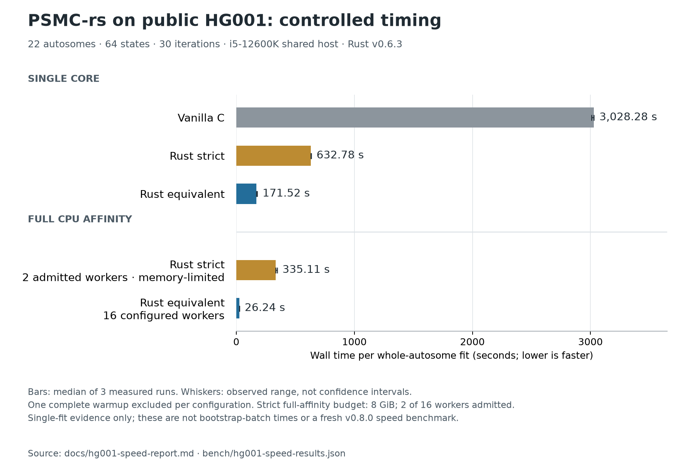

# PSMC-rs

[](https://github.com/DylanCosto/psmc-rs/actions/workflows/strict.yml)
[](LICENSE)

**Accelerated PSMC inference in Rust, with a reproducible local workflow.**
Use existing `.psmcfa` files, run deterministic parallel bootstraps, resume
interrupted batches, and export curves for plotting. Inference uses f64 throughout.

**Use `--mode strict` for exact C reproduction on the pinned, tested build.**
CPU fits default to equivalent mode, which changes floating-point rounding and
emits **QU instead of QD**. Existing third-party QD parsers need strict mode or
explicit QU support. Read the [mode guarantees](docs/modes-and-guarantees.md).

[Install binaries](docs/binary-install.md) · [Five-minute tutorial](docs/tutorial.md) ·
[Validation](docs/validation-overview.md) · [Releases](https://github.com/DylanCosto/psmc-rs/releases) ·
[Methods](docs/methods-note.md) · [Contribute](CONTRIBUTING.md)

## Install and run

Download the Linux **x86-64** or **ARM64** archive and its `.sha256` file from
[Releases](https://github.com/DylanCosto/psmc-rs/releases). Verify and extract it:

```sh
sha256sum -c psmc-rs-0.8.0-x86_64-unknown-linux-gnu.tar.gz.sha256
tar -xzf psmc-rs-0.8.0-x86_64-unknown-linux-gnu.tar.gz
cd psmc-rs-0.8.0-x86_64-unknown-linux-gnu
./psmc-rs --version
./psmc-rs --record-workers 2 --memory-mib 256 --seed 42 -N 5 \
  -o example.psmc examples/synthetic.psmcfa
```

Use the `aarch64-unknown-linux-gnu` filename on ARM64. Archives include checksums,
licenses, build provenance and synthetic example data. Python is only needed for
the optional plotting helper. See [binary requirements](docs/binary-install.md)
and [container installation](docs/container.md).

Or build locally with the pinned Rust 1.90.0 toolchain, a C linker and zlib:

```sh
cargo build --release --locked --offline
./target/release/psmc-rs -p '4+25*2+4+6' -N 30 -t 15 -r 5 -I 0 \
  --progress --memory-mib 8192 -o result.psmc input.psmcfa
```

There are no Cargo registry dependencies. Plain/gzip FASTA and FASTQ input and
stdin are supported. Input records remain independent HMM sequences; missing
bins are retained. Input binning/callability quality still determines what can
be inferred. Do not treat an absent VCF record as confident homozygous reference.

## Bootstrap, resume and plot

```sh
./psmc-rs inspect input.psmcfa
./psmc-rs split --block-bins 50000 --output blocks.psmcfa input.psmcfa
./psmc-rs bootstrap --replicates 30 --seed 42 --workers 8 --memory-mib 4096 \
  -p '4+25*2+4+6' -N 30 -t 15 -r 5 -I 0 --progress \
  --output-dir bootstrap-results blocks.psmcfa
```

The split size is in **bins**; choose it for your analysis. To resume, repeat the
bootstrap command with `--resume`. Completed fits are reused only after executable,
input, settings and output checksums agree. Interrupted fits restart from round
zero, with partial output preserved. See the [resume contract](docs/bootstrap-resume.md).

Worker counts obey a conservative memory admission estimate, not a hard RSS limit.
Strict mode retains full message histories; equivalent uses bounded checkpoints.
Input loading precedes admission. Set an explicit budget that leaves room for
other work. Defaults and legacy controls are in [CLI usage](docs/usage.md).

Export the last complete curve with explicit biological scaling:

```sh
./psmc-rs export --mutation-rate 1.25e-8 --generation-years 25 --bin-bp 100 \
  --output curve.csv result.psmc
```

These scaling values are illustrative assumptions. The [tutorial](docs/tutorial.md)
includes a local Matplotlib plotter and explains the final open time interval.
When reporting research, include the version and mode from `MM Version`, command,
input preparation, bootstrap procedure and scaling assumptions.

## Measured performance



The audited v0.6.3 comparison measured **17.66× single-core speedup** for equivalent
mode over vanilla C on one public HG001 whole-autosome fit. Full-affinity equivalent
took **26.24 seconds** on the tested i5-12600K. Strict's full-affinity measurement
admitted only two workers under an 8 GiB budget. Three measured runs and one excluded
warmup per configuration, shared host; these are not bootstrap-batch timings or
a fresh v0.8.0 speed benchmark. [Full results and ranges](docs/hg001-speed-report.md).

## Evidence and limits

Strict has pinned-C byte regressions. Equivalent has component tests, public-data
comparisons and known-truth panels. Linux x86-64 and ARM64 binaries pass native
regression and extraction tests; whole-genome scientific evidence is from x86-64.
The broader release panel passed its fixed screens on 30 matched whole-genome
bootstrap pairs and four additional 23/32-state public-input comparisons. The
[validation overview](docs/validation-overview.md) distinguishes each scope.

The original 20 Mb pilot's four outliers remain visible: their between-mode
likelihood paths are shallow, but all four have improving directions. Numerical
cancellation exists in extreme legacy models; a [stable-formula investigation](docs/stable-model-report.md)
remains outside production. Later passing panels do not erase failed screens.
No universal demographic recovery or untested-platform guarantee is made. A
successful process exit does not certify that every legacy calculation is finite.

Optional CUDA remains experimental and was slower than CPU in the measured
campaign. Native macOS/Windows packages and ARM performance claims are not included.
Your own input/splitting pipeline still needs validation.

## Citation and contribution

Please cite **Li & Durbin (2011), doi:[10.1038/nature10231](https://doi.org/10.1038/nature10231)**
and the PSMC-rs release used; [CITATION.cff](CITATION.cff) provides software metadata.
Original PSMC attribution is retained in [NOTICE.md](NOTICE.md); code is [MIT licensed](LICENSE).

[Contribution guide](CONTRIBUTING.md) · [Independent reproduction checklist](docs/external-pilot.md) ·
[Security reporting](SECURITY.md). Use synthetic issue reproducers; do not post genomes
or restricted data. Independent feedback is welcome and is not presumed endorsement.

For implementation detail, see [mathematical contracts](MATH_AND_COMPATIBILITY.md),
[validation policy](VALIDATION_AND_BENCHMARKS.md), [pinned C source](https://github.com/lh3/psmc/tree/82fa2ada83ee463fe1251b562ae3d60e82d7ad6a)
and [execution history](EXECPLAN.md).
